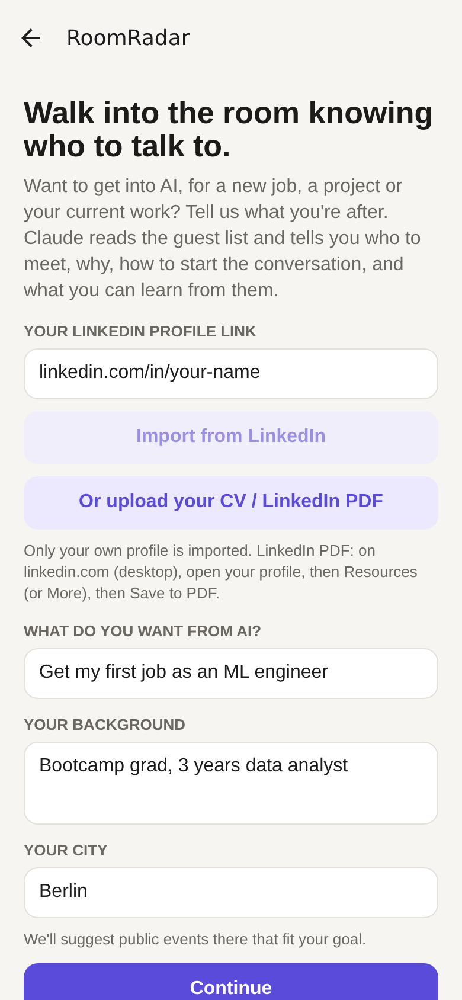
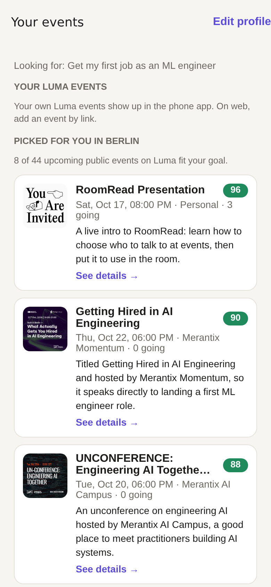
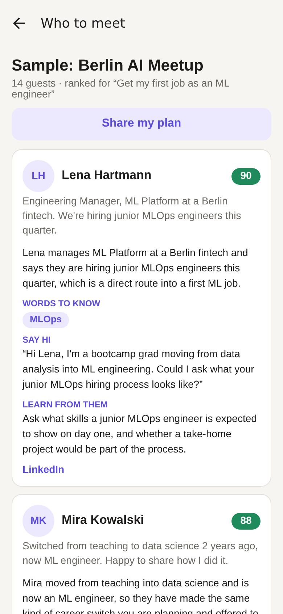
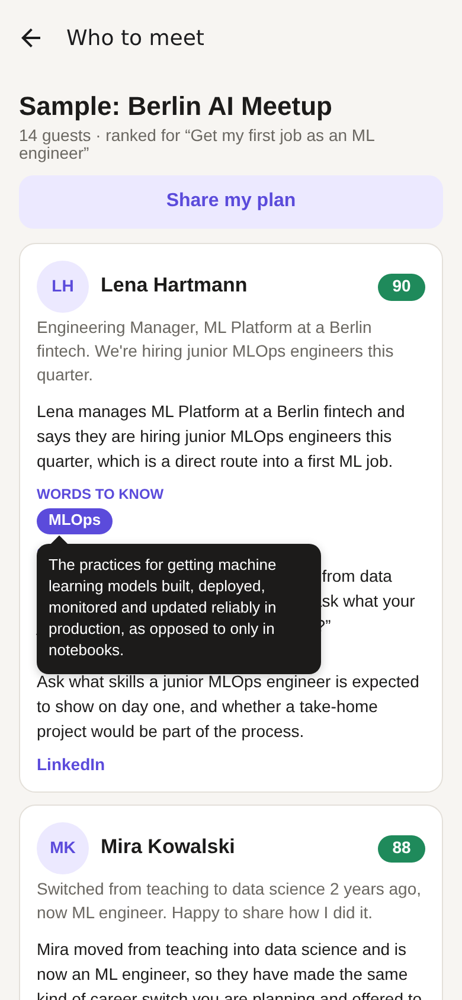

# RoomRadar

**One line:** Helps people who want to get into AI find out who to talk to at an AI meetup, why, and what to ask them.

## The problem
- **Audience:** people in Berlin who want to get into AI but don't know anyone working in it: career changers and junior engineers looking for a job, but also small business owners and workers in non-tech jobs who want to use AI in their work.
- **Their problem with AI today:** most of what you learn about AI, and most AI jobs, comes through people. Meetups are full of the right people, but newcomers don't know who's who, what to ask, or how to start the conversation, and the jargon makes it worse.
- **What the demo lets them do:** paste a Luma event link, and Claude ranks the guest list for *their* goal (a job, a project, or using AI at work). For each person it says why they're worth meeting, gives a conversation opener, and names one thing about AI work they could learn from them.

## What it does
1. You paste your own LinkedIn link (fetched once through Apify) or upload your CV / LinkedIn PDF, and Claude fills in what you want from AI and your background. You can also type them.
2. You pick an event:
   - **Picked for you:** Claude reads the upcoming public Luma events in your city and suggests the ones that fit your goal, each with a short reason.
   - **Your Luma events (mobile app):** sign in to Luma once inside the app to see the events you're going to, or add any event by its link.
   - **On the web:** paste the personal ticket link from your Luma confirmation email (`…?tk=…`) on the event page; it unlocks the guest list without a sign-in, through a narrow server relay that sends no cookies.
   - **Sample event:** a fake Berlin AI meetup, used for the demo.
   - **Paste:** names copied from Luma's guest list, or Luma's guest-list JSON.
3. Claude ranks everyone from 0 to 100. Each card shows *why*, *say hi* (an opener), *learn from them*, and *words to know*: AI terms from that person's profile (like "MLOps" or "RAG") that you tap to get a one-line plain explanation, so you can follow the conversation. You also see the person's public links.
4. *Share my plan* sends your top 5 people, why to meet them and what to say, as plain text.

## How Claude is used
- **Model:** `claude-haiku-5-5` (set once in `src/server/claude.ts`) through the Anthropic TypeScript SDK, with structured outputs (a Zod schema) so the app always gets valid JSON back. Haiku is fast and cheap, which suits a live demo.
- **What Claude reads:** your goal and background, plus each guest's name, short bio and *which* links they listed. It doesn't get the link URLs. For the team demo event only, it also gets a compact version of each teammate's LinkedIn profile, so it can score them on their full experience.
- **Event suggestions** (`app/api/discover+api.ts`, prompt in `prompts/events.ts`): Claude reads the names and hosts of your city's public Luma events and picks up to 8 that fit your goal.
- **CV import** (`app/api/profile+api.ts`, prompt in `prompts/cvImport.ts`): Claude reads the uploaded PDF and suggests your target role and a short background, leaving out contact details. The PDF isn't stored.
- **Finding LinkedIn profiles (demo event only)** (`app/api/find-linkedin+api.ts`, prompts in `prompts/findLinkedin.ts`): for guests with a full name but no LinkedIn link, Claude's web search suggests candidates, Apify loads them, and the match counts only if the name agrees *and* either one of their social handles is also the LinkedIn address or Claude finds something else that agrees (company, job, city, website). A hit shows as "Possible LinkedIn" and feeds the ranking. Built for our team's demo event, where every guest agreed; not for real events without the guests' consent.
- **What Claude produces:** a score, a one-line reason, a conversation opener, a learning tip and up to 3 AI terms from their profile explained for a newcomer, for every guest. It's told never to invent employers or titles, and to say so plainly when a profile is thin.
- **Where:** the call runs in a server route (`app/api/rank+api.ts`), so the API key never reaches the phone. The prompt lives in `prompts/rank.ts`.

## Privacy by design
- Your Luma sign-in stays on your phone. A hidden WebView makes the requests from inside Luma's own page, so the app never reads, stores or uploads your Luma session.
- LinkedIn import only fetches **your own** profile, from the link you paste. The app never looks up other guests on LinkedIn. The one exception is the team demo event below: its guests are our own teammates, who agreed.
- Guest data only lives in memory and is gone when you close the app. To avoid repeat calls to Claude, Luma and LinkedIn, the server keeps recent answers in memory for up to an hour (`src/server/cache.ts`) and forgets them on restart. The only thing saved to disk is the teammates' profiles for the team demo event (`data/team-event.json`, git-ignored). Raw LinkedIn data never leaves the server except to Claude.
- It only shows guests that you could already see on Luma yourself.
- The sample event uses **fake guests** (`data/sample-guests.json`). The only real people in the demo are our own teammates, who agreed.

## How to run it
```bash
cp .env.example .env    # paste your ANTHROPIC_API_KEY (and optionally APIFY_TOKEN) into .env; never commit it
npm install
npx expo start          # press w for web, or scan the QR code with Expo Go on your phone
```
- **Web:** the sample event and paste mode work, and a Luma guest list loads with your personal ticket link. Signing in to Luma to list *your* events needs the phone app.
- **Phone:** install **Expo Go** and scan the QR code. Your phone and laptop must be on the same Wi-Fi, because the app calls the ranking route on the laptop's dev server. If that doesn't work, set `EXPO_PUBLIC_API_URL=http://<laptop-ip>:8081` in `.env`.
- **Checks:** `npm run typecheck` and `npm test`.

**Heads-up about Luma:** Luma has no public guest API for guests, so `src/luma/config.ts` uses the internal endpoints luma.com itself calls. They weren't verified while building and may change. If live loading fails:
1. Open the event on luma.com, open DevTools and go to the Network tab.
2. Click "N Going".
3. Copy the real request URL into `src/luma/config.ts`.

Paste mode always works as a fallback.

## Team demo event (real, consenting teammates)
For the demo, our own teammates act as event guests, as if imported from Luma. All of them agreed to have their public LinkedIn profiles used. The flow in the app:
1. **Onboarding:** paste your LinkedIn link and tap *Import from LinkedIn*. Claude fills in your goal and background, and the app remembers your link.
2. **Your events → Team demo event → Find who to meet.** The server fetches the teammates' LinkedIn profiles through Apify, then Claude scores them using their full experience. You're left out automatically if your link is on the list.

Teammates' links are in `src/server/teamEvent.ts`; `TEAM_EVENT_LINKEDIN_URLS` in `.env` can override them. The first tap fetches the profiles, which takes up to a minute. They're then cached in the git-ignored `data/team-event.json` (never commit it), so later taps are instant and cost no extra Apify credit. No extra commands are needed. LinkedIn's terms prohibit scraping, so this only runs on teammates who agreed, never on profiles a user types in.

## Project layout
| Path | What it is |
|---|---|
| `app/onboarding.tsx` | First run: import your LinkedIn or CV, your goal, background and city |
| `app/events.tsx` | Picked-for-you events, your Luma events, add by link, sample and paste options |
| `app/event/[slug]/index.tsx` | One event's details: time, place, hosts, Claude's reason, description |
| `app/event/[slug]/people.tsx`, `app/results.tsx` | Ranked guest cards, jargon popups and *Share my plan* |
| `app/login.tsx` | Luma sign-in inside the app |
| `app/api/rank+api.ts` | Server route that calls Claude to rank guests |
| `app/api/profile+api.ts` | Server route where Claude reads your CV PDF |
| `app/api/linkedin+api.ts`, `src/server/apify.ts` | Server route that fetches your own LinkedIn profile via Apify for Claude |
| `app/api/team-event+api.ts`, `src/server/teamEvent.ts` | The team demo event: teammates' LinkedIn profiles via Apify, cached |
| `app/api/discover+api.ts`, `app/api/luma-event+api.ts`, `src/server/luma.ts` | Server routes for public Luma events: suggestions for your city, and lookup by link |
| `app/api/luma+api.ts`, `src/luma/proxy.ts` | Web-only relay for a guest list unlocked by a ticket link (no cookies, nothing stored) |
| `app/api/find-linkedin+api.ts`, `src/server/findLinkedin.ts` | Finds possible LinkedIn profiles for guests who didn't link one (web search, Apify, Claude); demo event only |
| `docs/luma-connection-handoff.md` | How the Luma import works and what it returns |
| `src/api.ts` | The app's calls to those server routes |
| `prompts/` | The Claude prompts (tweak them here) |
| `src/luma/` | Luma bridge (hidden WebView), endpoint config and response parsing |
| `data/sample-guests.json` | Fake guests for the demo |
| `src/server/claude.ts` | Shared Claude client and the model name |
| `docs/SPEC.md` | The product spec we built from |
| `tests/` | Unit tests for parsing, caching and the team event (Vitest) |

## Demo video and screenshots
- **2-minute demo video:** TODO: add the link (it must open for anyone)

| 1. Tell it your goal | 2. Events picked for you | 3. Who to meet, and why | 4. Tap a word to learn it |
|---|---|---|---|
|  |  |  |  |

The guests in these screenshots are fake sample guests.

## Team
| Name | Role / background |
|---|---|
| [Aigam Shamali](https://www.linkedin.com/in/aigam-shamali) | Product / Design |
| [Marcin Zelent](https://www.linkedin.com/in/marcinzelent/) | Founder |
| [Mate Steinforth](https://www.linkedin.com/in/matesteinforth) | Builder |
| [Robin Kryszak](https://www.linkedin.com/in/robin-kryszak) | Builder |
| [Sören Daehn](https://www.linkedin.com/in/soeren-daehn/) | Founder |

## Credits
- [Anthropic TypeScript SDK](https://github.com/anthropics/anthropic-sdk-typescript) and Claude
- [Expo](https://expo.dev) and [Expo Router](https://docs.expo.dev/router/introduction/)
- [React Native](https://reactnative.dev) and [react-native-web](https://necolas.github.io/react-native-web/)
- [react-native-webview](https://github.com/react-native-webview/react-native-webview)
- [expo-document-picker](https://docs.expo.dev/versions/latest/sdk/document-picker/)
- [Apify](https://apify.com) actor [harvestapi/linkedin-profile-scraper](https://apify.com/harvestapi/linkedin-profile-scraper) (your own profile, and the consenting teammates in the team demo event)
- [AsyncStorage](https://github.com/react-native-async-storage/async-storage)
- [Zod](https://zod.dev) and [Vitest](https://vitest.dev)
- [Luma](https://luma.com) (event data, through the user's own signed-in session)
